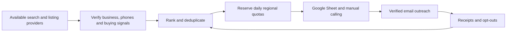

# Sellbird: daily property-dealer calling lists

Sellbird is an optional portable agent skill in [`skills/sellbird`](../skills/sellbird/SKILL.md).
It applies Sellbird's discovery, evidence and verification workflow to a daily
phone-first calling list: ten new property dealers each in Gurgaon, Mumbai and
Delhi NCR excluding Gurgaon, with website status, a service pitch, WhatsApp draft
and optional authorized email outreach. Existing Sellbird behavior is unchanged.

Copy the skill into Codex, Claude Code, Hermes, or another SKILL.md-compatible
harness. Python 3.11+ is sufficient for the offline ledger. Read the skill's
[operations guide](../skills/sellbird/references/operations.md) to configure
the host's search, Sheets and email tools and daily scheduler. Provider access,
email authentication and an awake host are prerequisites; installing a skill
alone does not create a 24/7 service. The target is thirty qualified contacts,
not a guarantee that every search source contains enough qualifying businesses.

The helper reserves each region's daily quota transactionally, keeps phone,
domain and place identities across runs, generates fixed-row Google Sheets
writes, and records a send claim before email delivery. Unknown delivery results
stay blocked for reconciliation. It never sends WhatsApp or makes calls.
There are no new runtime dependencies or changes to Sellbird's default sender.

Tests use fictional business records and mocked delivery boundaries. They cover
quotas, stale/unsupported evidence, geographic overlap, phone normalization,
cross-day deduplication, formula-safe sheet writes, read-back acknowledgement,
sender checks, suppressions and ambiguous email retries.
